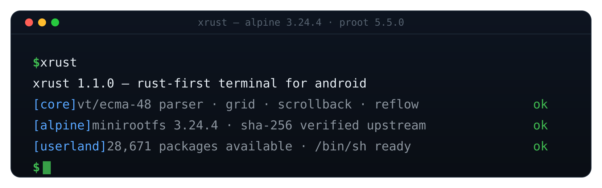
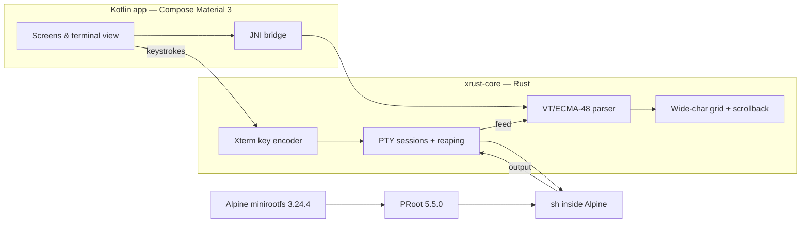

<div align="center">



**A Rust-first terminal for Android with a full Alpine Linux userland — no root required.**

[](https://github.com/vxyzview/xrust/actions/workflows/ci.yml)
[](https://github.com/vxyzview/xrust/releases/latest)
[](LICENSE)
[](https://developer.android.com)
[](https://www.rust-lang.org)
[](https://github.com/vxyzview/xrust/actions/workflows/ci.yml)

```
┌─ xrust ───────────────────────────────────────────────┐
│ core        Rust · VT/ECMA-48 parser · 135 tests      │
│ ui          Jetpack Compose · Material You 3          │
│ userland    Alpine 3.24.4 · 28 671 packages           │
│ sandboxing  PRoot 5.5.0 · no root required            │
│ themes      dynamic Material You + 4 app · 12 term    │
└───────────────────────────────────────────────────────┘
```

</div>

## How it fits together



- **Native core** (`xrust-core`, Rust): hand-written VT/ECMA-48 parser
  (CSI/OSC/DCS, sub-parameters, DEC special graphics), wide-char-aware grid,
  bounded scrollback with true soft-wrap reflow, selection with copy
  semantics, xterm-compatible key encoding, PTY/session management with
  correct child reaping, and a JNI bridge. 135 unit + integration tests,
  `clippy -D warnings` clean, `rustfmt` clean.
- **Android app** (Kotlin + Jetpack Compose Material 3): 12 screens —
  sessions, interactive terminal, installer, file manager, settings,
  display/font/scheme/keyboard pages, profiles + editor, about.
  25 tunable terminal parameters, **dynamic Material You color on
  Android 12+**, 4 complete-theme modes (incl. **AMOLED pure black** and
  **Rose Ash**) plus 12 terminal color schemes.
- **Alpine userland**: official `alpine-minirootfs-3.24.4` downloaded at
  runtime, SHA-256-verified against `dl-cdn.alpinelinux.org`, extracted
  safely (traversal/absolute-symlink rejected), driven by PRoot v5.5.0
  built per-ABI in CI.

## Screens

| # | Screen | Purpose |
|---|--------|---------|
| 1 | Sessions | session list, rootfs status |
| 2 | Terminal | interactive PTY terminal, extra-keys toolbar |
| 3 | Installer | download/verify/extract Alpine |
| 4 | Files | Android ↔ rootfs dual-pane manager |
| 5 | Settings | hub + 25 terminal parameters |
| 6 | Display | theme, AMOLED, cursor, bells |
| 7 | Font | family/size/line-height/spacing/DPI |
| 8 | Schemes | 12 terminal color schemes |
| 9 | Keyboard | extra keys, backspace, modifiers |
| 10 | Profiles | launch profiles |
| 11 | Profile editor | command/args/env/cwd |
| 12 | About | docs, JSON schema, limits |

## Install

Grab the signed APK from the latest release — every `v*` tag publishes
automatically:

```bash
gh release download -R vxyzview/xrust --pattern "app-release.apk"
adb install app-release.apk
```

Or download `app-release.apk` from the
[releases page](https://github.com/vxyzview/xrust/releases/latest) and
install it directly on the device (Android 8.0+, allow unknown sources).

## Verified end-to-end (Linux sandbox)

`scripts/e2e.sh` runs the whole stack on Linux: PTY → parser → grid →
PRoot → real `/bin/sh` inside Alpine 3.24.4:

```
alpine-minirootfs-3.24.4-x86_64.tar.gz: OK          # upstream SHA-256
test alpine_shell_filesystem_is_isolated ... ok
test alpine_shell_pipeline_and_colors  ... ok
test alpine_shell_reports_kernel_and_userland ... ok
test result: ok. 3 passed; 0 failed
OK: 28671 distinct packages available               # real `apk update`
E2E_ALL_GREEN
```

## Build from source

```bash
# Rust core tests
cd xrust-core && cargo test

# Android (requires ANDROID_NDK_HOME + cargo ndk)
./scripts/build-android-rust.sh          # all 4 ABIs → app/src/main/jniLibs
./gradlew assembleDebug

# PRoot binaries per ABI → app assets
./scripts/build-proot.sh arm64-v8a

# Linux e2e (no Android needed)
./scripts/e2e.sh
```

## Host shell (restricted)

Sessions can also run Android's own `/system/bin/sh` without PRoot.
This is intentionally limited by the OS sandbox — see
[docs/HOST_SHELL_LIMITS.md](docs/HOST_SHELL_LIMITS.md).

## License

MIT for this project. PRoot (GPL-2.0) is used as a separate executable;
see [LICENSE](LICENSE).
